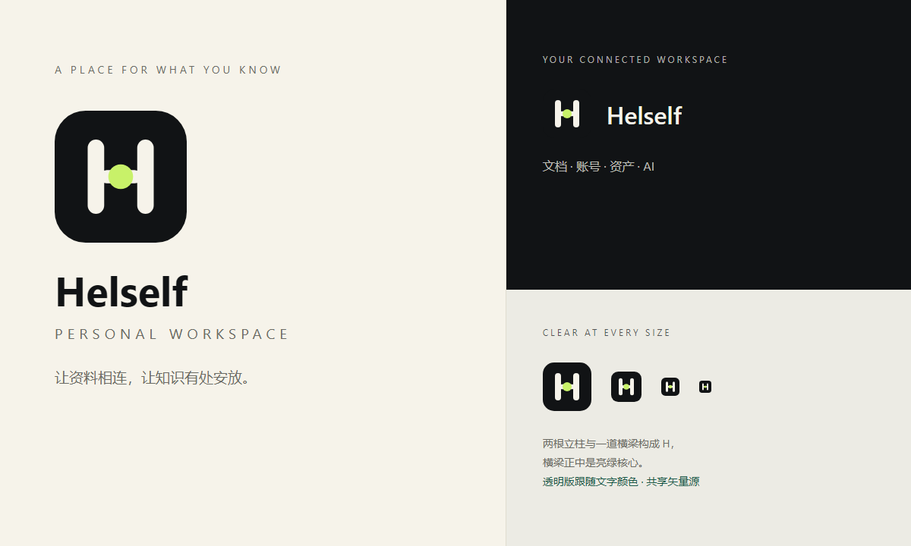

# Helself 品牌规范

Helself 是连接文档、账号与数字资产的个人工作空间。界面、安装包、产品主页、网页版、浏览器插件和分享卡共用同一套标志几何与配色；所有尺寸都从同一个矢量源生成，避免侧栏、任务栏和安装图标各自漂移。

本文件是视觉识别的说明文档。标志与色值的唯一事实来源是 `src/lib/brand-mark.mjs`；本文与源码不一致时以源码为准，并同步修正本文。



## 标志：核心 H

标志在 64×64 视图里由两根圆头立柱和一道横梁构成字母 **H**，横梁正中的几何中心嵌一颗亮绿圆点，即「核心」。

- **两根立柱**代表自持：各自独立、站得住，是每个人自己的资料、账号与判断。
- **横梁**代表连接：把两边连成一体，对应用户的主机、域名、证书、邮箱与文档之间的关系。
- **正中亮绿核心**代表被连接起来的知识与身份本身；它是整个标志里唯一固定不变的颜色。

标志在 16px 仍能读出 H 的轮廓：立柱宽 8 单位、内间距 16 单位，横梁与核心只占中段三分之一。图标版把图形放在深色圆角底板上，在任何背景与 Windows 任务栏上都有稳定轮廓；透明版的立柱跟随文字颜色，适合和字标一起出现。

### 几何参数

| 元素       | 参数                       | 值                                     |
| ---------- | -------------------------- | -------------------------------------- |
| 视图       | `viewBox`（图标版）        | `0 0 64 64`                            |
| 左立柱     | `x` / `y` / 宽 / 高 / 圆角 | `16` / `14` / `8` / `36` / `4`         |
| 右立柱     | `x` / `y` / 宽 / 高 / 圆角 | `40` / `14` / `8` / `36` / `4`         |
| 横梁       | `x` / `y` / 宽 / 高 / 圆角 | `22` / `28.75` / `20` / `6.5` / `3.25` |
| 核心       | 圆心 `cx, cy` / 半径 `r`   | `32, 32` / `6`                         |
| 图标底板   | `x, y` / 宽高 / 圆角       | `0, 0` / `64×64` / `15`                |
| 透明版视图 | `markViewBox`              | `11 11 42 42`                          |

几何关系：

- 立柱顶端 `y=14`、底端 `y=50`，左右外缘 `x=16` 与 `x=48`；在 64 视图内上下各留 14 单位、左右各留 16 单位。
- 横梁垂直中心为 `28.75 + 6.5 / 2 = 32`，与核心圆心重合；核心直径 12、大于横梁高度 6.5，因此上下各探出 2.75 单位，视觉上像一颗被横梁托住的珠子。
- 核心左右各与立柱内缘留 2 单位间隙（核心 `x` 26–38，立柱内缘 `x=24` 与 `x=40`）。这个间隙是标志的可读性来源，任何尺寸下都不要让核心碰到立柱。
- 透明版裁到 `11 11 42 42`，图形四周保留 3–5 单位呼吸空间；放进界面时不额外加内边距。

数值定义见 `src/lib/brand-mark.mjs` 的 `BRAND_MARK`，界面渲染见 `src/components/logo.tsx`。

## 两种版本与选择规则

| 版本   | 结构                                                  | 用在哪里                                                                      | 不要用在哪里                                               |
| ------ | ----------------------------------------------------- | ----------------------------------------------------------------------------- | ---------------------------------------------------------- |
| 图标版 | Ink 圆角底板（`rx=15`）+ Paper 立柱与横梁 + Lime 核心 | 应用图标、Windows `.ico`、favicon、分享卡、安装器、浏览器插件图标、独立图标位 | 正文里的行内标记（深色方块过重）、已有底板的容器里再叠一层 |
| 透明版 | 无底板；立柱与横梁跟随 `currentColor`，核心固定 Lime  | 标题、侧栏、字标、网站与文档示意图、和文字一起出现的场景                      | 背景不可控的图标位、需要独立辨认的 16px 位置               |

选择规则：

1. **有文字或主题上下文**用透明版：立柱继承当前文字颜色（浅色主题为 Ink，深色主题为 Paper），核心始终 Lime。
2. **独立图标位、背景不可控**用图标版：它的深色底板保证任何背景上都有轮廓。
3. 独立导出的透明 SVG（`public/brand/helself-mark.svg`）立柱用 Pine，供浅色底直接使用；深色底改用 Paper。核心仍是 Lime。
4. 同一屏里不要同时出现两种版本做同一件事；界面内不要给透明版再套圆角矩形、圆形或阴影底板。

## 色板

| 名称  | Hex       | 角色                               | 使用规则                                                     |
| ----- | --------- | ---------------------------------- | ------------------------------------------------------------ |
| Ink   | `#111315` | 深色底、浅色主题正文、图标底板     | 图标底板与主文字色；浅色主题里正文、标题、立柱都用它         |
| Paper | `#F6F3EA` | 浅色底、深色底上的前景、图标版立柱 | 页面底色与深色主题正文；不要用纯白替代，暖白是品牌的纸感来源 |
| Lime  | `#C8F169` | 品牌核心色                         | 只做填充与点缀：标志核心、深色底上的短强调、选中态与图表高亮 |
| Pine  | `#1D5B4A` | 浅色主题的链接与主按钮             | 浅色底上的可点击文字、主按钮底色；透明版在浅色底上的立柱色   |
| Mint  | `#7FE0BF` | 深色主题的链接与高亮               | 深色底上的链接、聚焦环、次级强调；不要放到浅色底上           |
| Clay  | `#F2764F` | 少量暖色点缀                       | 标签、图表第三序列、提醒的辅助色；浅色底上只做图形，不做正文 |

大致比例：Ink 与 Paper 占九成以上，Pine 与 Mint 约一成，Lime 只占百分之一二，Clay 更少。Lime 是标志的记忆点，不是界面主色。

### 对比度底线

按 WCAG 相对亮度公式计算的实际比值：

| 前景 / 背景  | 对比度 | 结论                                 |
| ------------ | ------ | ------------------------------------ |
| Ink / Paper  | 16.78  | 正文与标题                           |
| Paper / Ink  | 16.78  | 深色主题正文                         |
| Pine / Paper | 7.15   | 浅色主题链接与主按钮，达到 AAA       |
| Mint / Ink   | 11.81  | 深色主题链接与高亮                   |
| Lime / Ink   | 14.40  | 深色底上的短强调文字、图形填充       |
| Clay / Ink   | 6.63   | 深色底上的点缀文字                   |
| Lime / Paper | 1.17   | **禁止**做文字、线条图标或小面积描边 |
| Mint / Paper | 1.42   | **禁止**做文字；Mint 只属于深色底    |
| Clay / Paper | 2.53   | **禁止**做正文；只能做图形与色块     |

底线：浅色底上的正文与链接至少 4.5:1；大字号文字至少 3:1；图形与焦点框至少 3:1。调整主题或色值时按同一公式复算，不要凭肉眼判断。Lime 在浅色底上只能作为图形填充，永远不能承载文字。

## 字体与字标

- **字体**：Latin 与数字使用 Inter，中文回退到 PingFang SC、Microsoft YaHei、Noto Sans CJK SC、system-ui。不引入新字体、不新增字体依赖，字体文件不随仓库分发。
- **字标**：字标就是产品名 `Helself`，用 Inter 600–700、字距 0、仅首字母大写。不要写成 `HelSelf`、`HEL SELF`、`HEL-SEIF` 或全小写；句中普通指代同样写 `Helself`。
- **不做定制字形**：不为字标另画字母、不加描边、渐变、投影或立体效果，不把标记塞进字母里替代字形。标志负责识别，字标负责读出来。
- **界面锁定**：36px 透明标记 + 12px 间距 + 18px 粗体字标（见 `src/components/logo.tsx`）；品牌板与分享卡用 64px 标记 + 20px 间距 + 32px、字重 600 的字标。
- **中文副标题**：「个人知识与资产空间」是描述性副标题，可随界面文案调整，不是品牌名。
- **最小尺寸**：标记 + 字标的组合不小于 96px 宽；再小就只保留图标版，不保留字标。标记四周留白不少于图标高度的 25%。

## 使用禁忌

- **不拉伸、不压扁、不倾斜、不旋转**：只能等比缩放，保持正方形视图与圆角比例。
- **不换色**：核心永远是 Lime；立柱与横梁只用 Ink、Paper、Pine、Mint（透明版跟随文字颜色）。不用渐变、双色、透明叠加。
- **不加效果**：不加投影、发光、描边、立体、浮雕、贴图或动画变形。
- **不拆结构**：不把两根立柱拆开单独使用，不把横梁当减号或箭头，不把 H 改成别的字母，不移动或缩放核心，不让核心碰到立柱。
- **不套壳**：不在透明版外再加圆角矩形、圆形、盾形或另一种底板；图标版也不再叠放到别的底板或照片上。
- **不放到不可控背景**：照片、彩色插画、复杂纹理上只用图标版；透明版只放在能保证对比度的纯色或纸白底上。
- **Lime 禁令**：不做浅色底文字、不做细线图标、不做描边、不做渐变或透明叠加、不做大面积背景；深色底上只用于短强调，不用于长段正文。
- **不用字符代替**：不用 emoji、系统字体里的 `H`、CSS 画的三条矩形临时拼标志；所有位置都引用同一矢量源。
- **不再使用旧色板**：`#3B6FE0`、`#3F6FD8`、`#8DB0F5`、`#2BB3C0`、`#208D98`、`#FFB23F`、`#254D9B`、`#EEF4FE`、`#CEDDF6`、`#DCE6FA`、`#DDE5F0` 已全部退役，新界面、新截图和新文档里都不再出现。

## 资产清单与生成

| 源文件                    | 作用                                                                 |
| ------------------------- | -------------------------------------------------------------------- |
| `src/lib/brand-mark.mjs`  | 唯一矢量源：`BRAND_MARK`、`brandMark()`、`brandIcon()`、`brandSvg()` |
| `src/components/logo.tsx` | 界面内的透明版标记与字标组合                                         |
| `scripts/make-icon.mjs`   | 生成所有位图、`.ico`、三处 favicon、品牌预览与分享卡                 |

重新生成（需要已安装的依赖与 Playwright Chromium）：

```bash
npx playwright install chromium   # 首次
node scripts/make-icon.mjs
```

一次运行会覆盖下列文件，**不要手改生成物**：

| 文件                               | 尺寸 / 格式                                 | 用途                                        |
| ---------------------------------- | ------------------------------------------- | ------------------------------------------- |
| `build/icon.png`                   | 512×512 PNG，圆角外透明                     | 图标母版，桌面安装包与 `site/icon.png` 的源 |
| `build/icon.ico`                   | 16 / 24 / 32 / 48 / 64 / 128 / 256 PNG 图层 | Windows 程序、安装器与快捷方式图标          |
| `public/favicon.svg`               | 64×64 SVG（图标版）                         | 网页版与 PWA 的 favicon                     |
| `site/favicon.svg`                 | 同上                                        | 产品主页 favicon                            |
| `selfhost/public/favicon.svg`      | 同上                                        | 自托管网页版 favicon                        |
| `public/brand/helself.svg`         | 64×64 SVG（图标版）                         | README 与可复用图标                         |
| `public/brand/helself-mark.svg`    | 42×42 视图 SVG（透明版，立柱 Pine）         | 和字标组合、浅色底上的可复用标记            |
| `public/brand/helself.png`         | 复制自 `build/icon.png`                     | 位图图标                                    |
| `public/brand/helself-preview.png` | 1200×720 PNG                                | 品牌板，本文顶部预览                        |
| `public/og.jpg`                    | 1200×630 JPEG（质量 90，约 45 KB）          | 链接分享卡                                  |
| `site/icon.png`                    | 复制自 `build/icon.png`                     | 产品主页图标                                |
| `public/brand/icon-*.png`          | 16 / 32 / 48 / 128 / 180 / 192 / 512 PNG | 扩展工具栏、管理页与 PWA 图标 |
| `public/brand/icon-maskable-*.png` | 180 / 192 / 512 PNG，实色底板 | iOS 主屏幕与 Android 可裁切图标 |
| `public/manifest.webmanifest`     | Helself 名称、配色与图标清单 | 应用主屏幕身份 |
| `build/installerSidebar.bmp`      | 164×314，24 位 BMP | 离线安装与卸载向导侧栏 |
| `build/installerHeader.bmp`       | 150×57，24 位 BMP | 离线安装向导页眉 |

打包时 `build/icon.ico` 会被复制为安装目录下的 `resources/helself.ico`，任务栏与快捷方式统一使用它；升级安装后会刷新已存在的入口并通知资源管理器更新图标。Windows Shell 分组使用 `dev.helself.app`，系统显示名为「Helself」。

安装器、卸载器、在线引导器与原生终端都显式使用同一图标。平台安装教程的资源保留；应用自己的 manifest 和触摸图标优先，注入器只补缺失标签，不额外插入模板应用图标。

`windows-icon-check.ps1` 将 Windows Shell 或实际窗口返回的图像与当前品牌母版比较，并输出差异；不再用旧配色的像素比例判断。验收包含拒绝默认 Electron 图标的反例。

改动流程：先改 `src/lib/brand-mark.mjs`，再运行 `node scripts/make-icon.mjs`，然后检查图标在 16px 与 256px、浅色与深色背景、favicon 三处和分享卡上的实际效果；界面里的透明版会自动跟随新几何，不需要单独改。提交时连同生成物一起提交。

## 兼容性标识

以下标识**保持原样**，与显示品牌无关，改动会破坏升级、备份恢复或已部署的客户端。它们不出现在界面、安装包或新导出文件的显示名称里。

| 标识                                                                                | 为什么保留                                                                                |
| ----------------------------------------------------------------------------------- | ----------------------------------------------------------------------------------------- |
| `Nanpad` 数据目录与会话目录                                                         | 升级时用来定位已有资料；重命名会让老用户看起来像丢了数据。界面显示名可改，目录名不可改。  |
| `nanpad://` 协议                                                                    | 已安装客户端注册的回调协议与浏览器插件配对入口；改协议需要两端同时升级并重新注册。        |
| 旧备份的扩展名与文件格式标记                                                       | 用于读取旧版备份；新备份使用当前格式。                                                    |
| [探针协议](../services/probe/proto/probe.proto)的 gRPC 包名                          | 已部署的探针按现有包名连接，改名会中断连接。                                              |
| [MIT 许可文件](../LICENSE)中的版权与许可声明                                        | 分发时须保留。                                                                            |
| 仓库地址 `addxiaoyi/HEL-SEIF`                                                       | 发行、更新检查、GitHub Pages 产品页与下载链接都指向它；地址变更会让旧版本的更新检查失效。 |
| Docker 镜像 `ghcr.io/addxiaoyi/helself-web`                                         | 已部署网页版的升级源；镜像名不随显示品牌调整。                                            |
| Windows AppUserModelId `dev.helself.app`                                            | 任务栏分组与快捷方式身份；改动会让已安装用户出现两个任务栏图标。                          |

发行文件名与程序名继续使用 `Helself-版本号-setup.exe`、`Helself-版本号-portable-x64.zip`、`Helself-版本号-browser-extension.zip`、`Helself.exe`，扩展目录为 `helself-browser-extension`。产品名在所有对外文案中统一写作 `Helself`，不使用中文品牌名。
